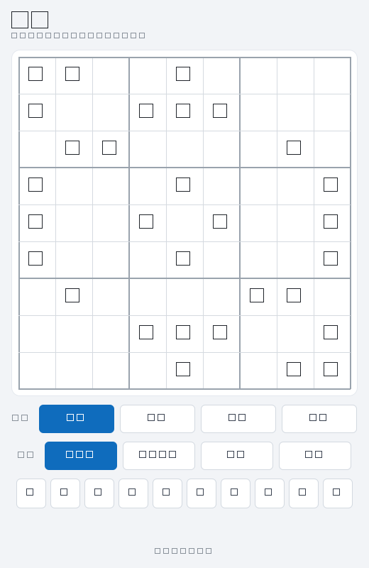
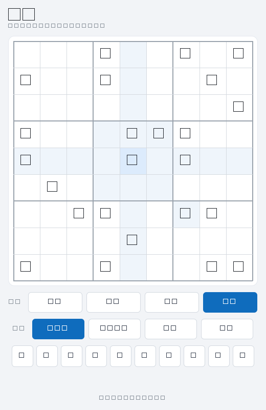
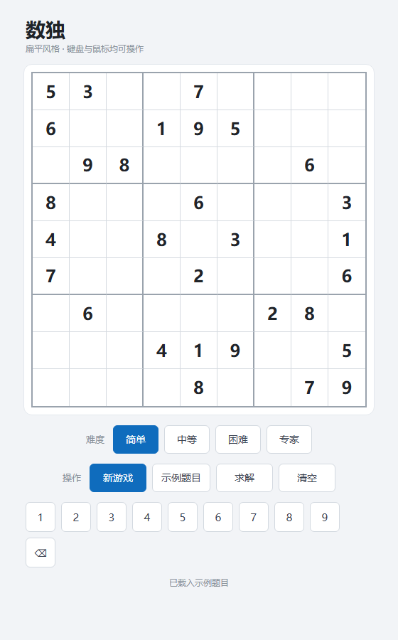

# 数独求解器（Sudoku Solver）

一个扁平风格的数独程序，包含两个版本：

- **桌面版**：Qt 6 + QML（Quick Controls FluentWinUI3 风格），支持 Windows / Linux / macOS；
- **网页版**：纯 HTML/CSS/JS，零依赖、零构建，浏览器双击即玩。

两个版本共享同一套算法设计：位掩码 + MRV 回溯求解，挖洞法随机出题（唯一解保证），四档难度。

## 功能特性

- **随机新题**：简单 / 中等 / 困难 / 专家四档难度（提示数 42 / 34 / 28 / 24），逐格挖洞验证唯一解；
- **一键求解**：MRV 启发式回溯，秒级求解，求解结果以蓝色显示；
- **冲突高亮**：行 / 列 / 宫重复实时标红，冲突时拒绝求解并给出提示；
- **灵活输入**：点选格子 + 键盘（`1-9`、小键盘、方向键、`Backspace`/`Delete`）+ 屏幕数字键盘；
- **示例题目 / 清空**：一键载入内置示例或清空盘面；
- **扁平化界面**：桌面版与网页版同款配色体系。

## 截图

**桌面版（Qt Quick + FluentWinUI3）**




**网页版（零依赖）**



## 目录结构

```
├── main.cpp / engine.h / engine.cpp  —— 入口、QML 后端单例（盘面/选择/冲突/操作）
├── Main.qml                          —— 桌面版扁平化界面
├── qtquickcontrols2.conf             —— Fluent WinUI3 控件风格
├── sudoku_core.h / sudoku_core.cpp   —— 校验 / 求解 / 题目生成（纯算法，无 UI 依赖）
├── CMakeLists.txt                    —— 桌面版构建
├── web/
│   ├── index.html                    —— 网页版页面结构
│   ├── style.css                     —— 扁平化样式（与桌面版同款配色）
│   ├── app.js                        —— 算法 1:1 移植 + 交互逻辑
│   └── test.js                       —— Node 算法自检
├── doc.txt                           —— 构建 / 部署 / 自检说明
├── blog-数独求解器.md                —— 博客：Win32 原生版实现
└── blog-数独求解器重构记.md          —— 博客：Win32 → Qt Quick + 网页版重构
```

## 桌面版构建

要求：Qt 6.5+（`Quick`、`QuickControls2` 组件）、CMake 3.20+、C++17 编译器。

```powershell
cmake -S . -B build-qt -G Ninja -DCMAKE_BUILD_TYPE=Release -DCMAKE_PREFIX_PATH=D:/Qt/<版本>/<套件>
cmake --build build-qt
build-qt\sudoku_gui.exe
```

Windows 发布部署（把 Qt 运行库与 QML 模块复制到 exe 目录，`--qmldir` 必须带，否则 FluentWinUI3 样式不部署）：

```powershell
windeployqt --release --no-translations --qmldir . build-qt\sudoku_gui.exe
```

无窗口回归自检（离屏渲染三种场景并截图）：

```powershell
set QT_QPA_PLATFORM=offscreen
build-qt\sudoku_gui.exe --screenshot shot.png --scenario sample   # sample | expert | solved
```

## 网页版运行

直接双击 `web/index.html` 用浏览器打开即可，无需构建、无需服务器。

算法自检（20 余项断言：唯一解、难度提示数、求解/冲突处理）：

```bash
node web/test.js
```

## 算法说明

- **求解**：位掩码记录行列宫占用，MRV（最少剩余候选）启发式选格回溯，2000 万节点安全阀防止病态输入卡死；
- **出题**：挖洞法 —— 随机填满完整盘 → 随机顺序挖空 → 每挖一格数解数（数到 2 即停）验证唯一解，不唯一则填回；
- **难度**：由提示数定义（42 / 34 / 28 / 24），困难 / 专家档给更多重试机会。

## 相关文章

- [blog-数独求解器.md](blog-数独求解器.md) —— 从零写一个 Windows 原生数独求解器（Win32 + 位掩码回溯）
- [blog-数独求解器重构记.md](blog-数独求解器重构记.md) —— 从 Win32 到 Qt Quick 与网页版的重构历程

## License

[MIT](LICENSE)
